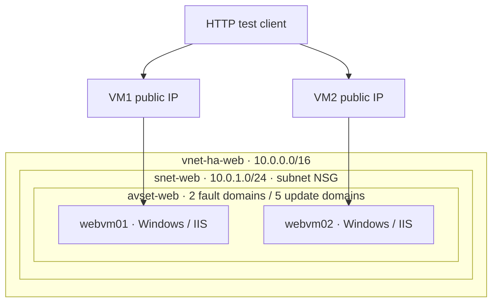

# Compute architecture

The availability set is placement metadata, not a network hop. Both VMs share a subnet NSG. HTTP is allowed for testing; RDP requires an explicitly supplied administrator IPv4 /32. There is no load balancer or configured HTTPS listener in this implementation.

The [original diagram](High-availability-webserver-architecture.drawio.png) is retained for history. Its single-public-IP path through the availability set is conceptual and should not be read as the deployed traffic flow.

[Deployment guide](../README.md)
